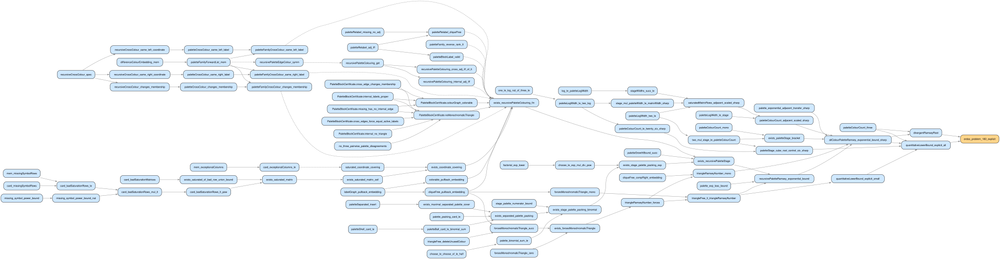

# Ten Advances in Mathematics and Theoretical Computer Science

This repository contains Lean 4 formalizations of the results presented in
[Ten advances in mathematics and theoretical computer science](https://openai.com/index/ten-advances-in-mathematics/) by OpenAI.

- [Read the paper](https://cdn.openai.com/pdf/ten-proofs-oai.pdf)
- [Read the reasoning walkthroughs](https://cdn.openai.com/pdf/reasoning-walkthroughs.pdf)

> This is a copy of [openai/ten-proofs](https://github.com/openai/ten-proofs)
> with one addition: a **dependency graph of every proof**, in the
> [`scripts/`](scripts/) folder. The Lean files themselves are unchanged.

## Proof dependency graphs

The ten proofs are hard to read: each Lean file is between 3,000 and 130,000
lines, a flat list of hundreds or thousands of lemmas. The graphs below show how
each proof is organised. Every box is a theorem, and an arrow from `A` to `B`
means `B` uses `A`, so following the arrows leads from the basic lemmas on the
left to the main theorem (orange) on the right.

[](scripts/en/svg/erdos_problem_183_explicit.svg)

*The smallest graph: the 95 theorems behind the multicolor Ramsey bound. Click to enlarge.*

| Result | Theorems | English | 中文 |
|---|---:|---|---|
| 1. Sphere packing | 1,648 | [SVG](scripts/en/svg/sharpFullCohnElkiesManuscriptConclusions.svg) · [PDF](scripts/en/pdf/sharpFullCohnElkiesManuscriptConclusions.pdf) | [SVG](scripts/zh/svg/sharpFullCohnElkiesManuscriptConclusions.zh.svg) · [PDF](scripts/zh/pdf/sharpFullCohnElkiesManuscriptConclusions.zh.pdf) |
| 2. Binary codes | 2,468 | [SVG](scripts/en/svg/binaryRate_lt_mrrw.svg) · [PDF](scripts/en/pdf/binaryRate_lt_mrrw.pdf) | [SVG](scripts/zh/svg/binaryRate_lt_mrrw.zh.svg) · [PDF](scripts/zh/pdf/binaryRate_lt_mrrw.zh.pdf) |
| 2. Spherical codes | 3,569 | [SVG](scripts/en/svg/strict_hierarchy.svg) · [PDF](scripts/en/pdf/strict_hierarchy.pdf) | [SVG](scripts/zh/svg/strict_hierarchy.zh.svg) · [PDF](scripts/zh/pdf/strict_hierarchy.zh.pdf) |
| 3. Non-sofic groups | 1,109 | [SVG](scripts/en/svg/exists_finitelyPresented_nonsofic_group.svg) · [PDF](scripts/en/pdf/exists_finitelyPresented_nonsofic_group.pdf) | [SVG](scripts/zh/svg/exists_finitelyPresented_nonsofic_group.zh.svg) · [PDF](scripts/zh/pdf/exists_finitelyPresented_nonsofic_group.zh.pdf) |
| 4. Connes’s rigidity conjecture | 1,710 | [SVG](scripts/en/svg/exists_infinite_pairwise_nonisomorphic_propertyT_icc_groups_with_isomorphic_factors.svg) · [PDF](scripts/en/pdf/exists_infinite_pairwise_nonisomorphic_propertyT_icc_groups_with_isomorphic_factors.pdf) | [SVG](scripts/zh/svg/exists_infinite_pairwise_nonisomorphic_propertyT_icc_groups_with_isomorphic_factors.zh.svg) · [PDF](scripts/zh/pdf/exists_infinite_pairwise_nonisomorphic_propertyT_icc_groups_with_isomorphic_factors.zh.pdf) |
| 5. Permanent lower bound | 247 | [SVG](scripts/en/svg/permanent_rational_formula_logarithmic_lower_bound.svg) · [PDF](scripts/en/pdf/permanent_rational_formula_logarithmic_lower_bound.pdf) | [SVG](scripts/zh/svg/permanent_rational_formula_logarithmic_lower_bound.zh.svg) · [PDF](scripts/zh/pdf/permanent_rational_formula_logarithmic_lower_bound.zh.pdf) |
| 6. Quantum parallel repetition | 1,816 | [SVG](scripts/en/svg/distributionUniformExponential.svg) · [PDF](scripts/en/pdf/distributionUniformExponential.pdf) | [SVG](scripts/zh/svg/distributionUniformExponential.zh.svg) · [PDF](scripts/zh/pdf/distributionUniformExponential.zh.pdf) |
| 7. Closest vector problem | 3,522 | [SVG](scripts/en/svg/gapCVP400IsNPHard.svg) · [PDF](scripts/en/pdf/gapCVP400IsNPHard.pdf) | [SVG](scripts/zh/svg/gapCVP400IsNPHard.zh.svg) · [PDF](scripts/zh/pdf/gapCVP400IsNPHard.zh.pdf) |
| 8. Ehrhart’s volume conjecture | 1,862 | [SVG](scripts/en/svg/ehrhart_volume_inequality_for_sets.svg) · [PDF](scripts/en/pdf/ehrhart_volume_inequality_for_sets.pdf) | [SVG](scripts/zh/svg/ehrhart_volume_inequality_for_sets.zh.svg) · [PDF](scripts/zh/pdf/ehrhart_volume_inequality_for_sets.zh.pdf) |
| 9. Multicolor Ramsey numbers | 95 | [SVG](scripts/en/svg/erdos_problem_183_explicit.svg) · [PDF](scripts/en/pdf/erdos_problem_183_explicit.pdf) | [SVG](scripts/zh/svg/erdos_problem_183_explicit.zh.svg) · [PDF](scripts/zh/pdf/erdos_problem_183_explicit.zh.pdf) |
| 10. Compactness conjecture | 355 | [SVG](scripts/en/svg/quantitativeCompactnessCounterexample.svg) · [PDF](scripts/en/pdf/quantitativeCompactnessCounterexample.pdf) | [SVG](scripts/zh/svg/quantitativeCompactnessCounterexample.zh.svg) · [PDF](scripts/zh/pdf/quantitativeCompactnessCounterexample.zh.pdf) |
| 10. Two-degenerate graphs | 309 | [SVG](scripts/en/svg/twoDegenerateExtremalCounterexample.svg) · [PDF](scripts/en/pdf/twoDegenerateExtremalCounterexample.pdf) | [SVG](scripts/zh/svg/twoDegenerateExtremalCounterexample.zh.svg) · [PDF](scripts/zh/pdf/twoDegenerateExtremalCounterexample.zh.pdf) |

- **Solid arrow:** the proof cites that theorem directly.
- **Dashed arrow:** the dependency goes through a definition that is not drawn.
- **Large graphs:** only results 5, 9 and 10 are small enough to read
  comfortably. The others have over a thousand theorems each, and GitHub may
  refuse to preview them; download the SVG and open it in a web browser, then
  zoom and search by name.
- **Chinese labels:** result 9 was translated by hand; the rest are translated
  word by word from a glossary.

How to read the graphs, what else is in the folder, and how to regenerate
everything: [scripts/README.md](scripts/README.md) ·
[中文说明](scripts/README.zh.md).

## The results

1. **High-dimensional sphere packing:** Improved asymptotic upper bounds on
   sphere-packing density, reaching the Cohn–Elkies threshold.
   ([`SpherePacking.lean`](SpherePacking.lean))
2. **Binary and spherical codes:** Exponentially stronger upper bounds for
   binary codes at every minimum distance, together with corresponding bounds
   for spherical codes. ([`MetricCodes.lean`](MetricCodes.lean))
3. **Non-sofic groups:** A construction of a non-sofic group, resolving whether
   every group admits finite permutation approximations.
   ([`NonSoficGroup.lean`](NonSoficGroup.lean))
4. **Connes’s rigidity conjecture:** A counterexample to the conjecture that
   certain groups are determined by their group von Neumann algebras.
   ([`ConnesRigidity.lean`](ConnesRigidity.lean))
5. **Arithmetic circuit complexity:** New lower bounds for computing the
   permanent with arithmetic circuits and formulas, including an
   $n^4 / \log n$ formula lower bound.
   ([`Permanent.lean`](Permanent.lean))
6. **Quantum parallel repetition:** Exponential parallel repetition for
   arbitrary finite, two-player quantum games.
   ([`QuantumParallelRepetition.lean`](QuantumParallelRepetition.lean))
7. **Closest vector problem:** Polynomial-factor hardness of approximation for
   the closest vector problem, with related consequences for decoding and
   lattice problems. ([`GapCVP.lean`](GapCVP.lean))
8. **Ehrhart’s volume conjecture:** The sharp maximum volume in every dimension
   for a convex body whose centroid is its only interior lattice point.
   ([`EhrhartVolumeInequality.lean`](EhrhartVolumeInequality.lean))
9. **Multicolor Ramsey numbers:** A superexponential lower bound for multicolor
   triangle Ramsey numbers, resolving Erdős problem 183.
   ([`MulticolorTriangleRamsey.lean`](MulticolorTriangleRamsey.lean))
10. **Extremal number conjectures:** Counterexamples to the compactness and
    degeneracy conjectures in extremal graph theory, resolving Erdős problems
    146 and 180.
    ([`CompactnessAndDegeneracy.lean`](CompactnessAndDegeneracy.lean))

## Building the formalizations

The project uses Lean 4.32.0, mathlib, and Lake. With
[elan](https://github.com/leanprover/elan) installed, fetch the mathlib cache
and build all ten formalizations with:

```sh
lake exe cache get
lake build All
```

To build an individual formalization, pass its module name to Lake:

```sh
lake build SpherePacking
```

## Independent proof checking

For instructions on checking the formalizations with Comparator, see the
[ComparatorChallenges README](ComparatorChallenges/README.md).
